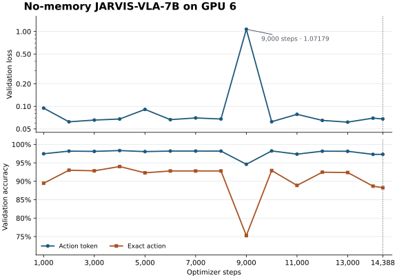

# 阶段 3 无记忆模型训练报告 · GPU 6

2026 年 11 月 23 日，北京时间。运行目录为 `results/phase3-speed-xOn8Q5je`，对应第二版遮挡布景和新版冻结索引。

**训练完成，正式检查点已保存。** GPU 6 完成 **14,388 个优化步**和 **57,549 条回程动作监督**。最终验证损失为 **0.06798**，动作 token 准确率为 **97.31%**，整条动作完全匹配率为 **88.25%**。原版可见导航成功 **6/10**，新版偏角视野内成功 **11/15**，分别低于各自门槛。正式 30 格评测在前置检查退出，四档的冻结种子评测结果仍缺失。

## 1. 训练配置与数据

| 项目 | 本次设置 |
| --- | --- |
| 硬件 | 单卡 GPU 6，NVIDIA A100-SXM4-40GB |
| 骨干 | JARVIS-VLA Qwen2-VL-7B 公开权重，BF16，LoRA |
| 输入 | 当前图像与前 2 帧、相应历史动作和指令。使用默认图像处理配置，`resolution=null` |
| LoRA | Rank 64，alpha 128，dropout 0.05。LLM 注意力的 Q、K、V、O 投影及 MLP 的 gate、up、down 投影共 161,480,704 个可训练参数 |
| 视觉与显存 | 冻结视觉编码器，缓存视觉特征，开启梯度检查点 |
| 监督 | 仅在返回段的目标动作 token 上计算交叉熵。外出图像可进入最近两帧历史 |
| 优化 | AdamW，固定学习率 0.0001，权重衰减 0.01，梯度范数裁剪 1.0 |
| 批大小和轮次 | 训练微批 1，累积 4 条动作更新一次，最后一步处理剩余 1 条。1 个 epoch，训练随机种子 20261122 |
| 验证与模型选择 | 每 1,000 步在固定验证集上验证，验证批大小 4，最终一步另验。按预定规则使用第 14,388 步适配器 |

[实机训练配置](phase3-speed-xOn8Q5je/train-no_memory/training_config.json) · [LoRA 配置](phase3-speed-xOn8Q5je/train-no_memory/adapter/adapter_config.json) · [训练实现](../code/minemem/t1_train.py)

| 数据划分 | 索引选中帧 | 回程动作标签 |
| --- | ---: | ---: |
| 训练，10 格 | 25,000 | 5,023 |
| 训练，30 格 | 25,000 | 10,948 |
| 训练，60 格 | 25,000 | 11,416 |
| 训练，100 格 | 25,000 | 11,696 |
| 训练，5–10 格可见导航 | 20,000 | 18,466 |
| **训练合计** | **120,000** | **57,549** |
| 验证 | 6,500 | 2,401 |
| 测试 | 6,500 | 2,388 |

完整索引 SHA-256 为 `f3a152816553499197053e18ce60e3837c899bed582eaa4cd913a71f52b5cefb`，服务器与工作区的复算值一致。索引选中 1,036 个回合。训练、验证、测试间的世界种子交集、与冻结评测世界种子的交集、重复场景种子和重复轨迹指纹均为 0。GPU 6 从节点本地 RAM 文件系统读入已校验的 1,036 份 ZIP，共 6,013,279,786 字节。另有逐文件核验的节点磁盘副本。 [冻结索引摘要](data/t1-screened-hzw7nYp7/index-full/summary.json) · [索引哈希](data/t1-screened-hzw7nYp7/index_sha256.json) · [归档校验记录](phase3-speed-xOn8Q5je/archive_sha256_disk.jsonl)

## 2. GPU 6 运行与检查点

| 时间 | 事件 |
| --- | --- |
| 07:10:48 | 新版训练启动 |
| 19:18:01 | 写入第 14,388 步训练记录 |
| 19:23:13 | 最终验证结束，适配器及训练摘要落盘 |
| 19:23:24 | 启动两版可见导航 |
| 19:41:57 | 原版 10 个回合全部落盘 |
| 20:15:43 | 新版偏角 20 个回合全部落盘 |
| 20:16:34 | 正式评测前置检查退出 |
| 22:29:54 | GPU 6 空闲，显存 0 MiB，利用率 0%，37°C |

训练程序计时 **43,936.16 秒（12 小时 12 分 16 秒）**，含初始化、验证和保存。15 次验证合计 **5,082.15 秒（1 小时 24 分 42 秒）**，其中首次约 12 分钟，后续中位数约 5 分 11 秒。端到端吞吐为 **1.31 条监督动作/秒**。从总计时扣除验证后为 **1.48 条/秒**，仍包含数据读取、视觉编码和保存等开销。PyTorch 峰值显存分配为 **21,111.76 MiB（20.62 GiB）**。

训练退出码为 0，CSV 覆盖步骤 1–14,388，记录完整。可恢复快照每 1,000 步写入，最终保留第 13,000 与 14,000 步。每份约 1.20 GiB，包含 LoRA、优化器、学习率调度器、随机数状态和回合内数据游标。最终评测适配器为 **645,975,704 字节（616.05 MiB）**，服务器上已复算 SHA-256。 [训练摘要](phase3-speed-xOn8Q5je/train-no_memory/summary.json) · [逐步损失](phase3-speed-xOn8Q5je/train-no_memory/loss.csv) · [训练日志](phase3-speed-xOn8Q5je/no_memory.log) · [恢复验收](REPORT_phase3_screened_launch.md#数据与断点)

| 服务器交付物 | 值 |
| --- | --- |
| 最终适配器，相对于运行目录 | `train-no_memory/adapter/adapter_model.safetensors` |
| 最终适配器 SHA-256 | `6ed32d5eb633c26f80aea8e3e677cbc1f1f5b136e4be2023d5a92ae06dd9c6be` |
| 最近可恢复快照，相对于运行目录 | `train-no_memory/checkpoints/step-00013000/state.pt`、`train-no_memory/checkpoints/step-00014000/state.pt` |

## 3. 开环验证

15 次验证均覆盖同一批 6,500 帧、2,401 条回程动作和 11,751 个目标 token。验证在教师历史及目标动作前缀下计算逐 token 交叉熵与 argmax 准确率。整条动作完全匹配要求该动作的全部目标 token 都匹配。图中损失采用对数纵轴。 [原始验证 CSV](phase3-speed-xOn8Q5je/train-no_memory/val_loss.csv) · [验证曲线 SVG](phase3-speed-xOn8Q5je/train-no_memory/validation.svg)

| 优化步 | 验证损失 | Token 准确率 | 整条动作完全匹配率 |
| ---: | ---: | ---: | ---: |
| 1,000 | 0.09476 | 97.46% | 89.46% |
| 2,000 | 0.06219 | 98.18% | 93.00% |
| 3,000 | 0.06562 | 98.11% | 92.84% |
| 4,000 | 0.06773 | **98.33%** | **94.00%** |
| 5,000 | 0.09108 | 98.05% | 92.29% |
| 6,000 | 0.06649 | 98.20% | 92.79% |
| 7,000 | 0.07005 | 98.20% | 92.79% |
| 8,000 | 0.06784 | 98.19% | 92.79% |
| 9,000 | 1.07179 | 94.61% | 75.26% |
| 10,000 | 0.06238 | 98.23% | 92.92% |
| 11,000 | 0.07832 | 97.36% | 88.88% |
| 12,000 | 0.06496 | 98.16% | 92.46% |
| 13,000 | **0.06159** | 98.14% | 92.38% |
| 14,000 | 0.06961 | 97.30% | 88.67% |
| **14,388（用于闭环）** | **0.06798** | **97.31%** | **88.25%** |

首步和末步训练损失分别为 5.03654、0.00237，首 100 步与末 100 步平均损失分别为 0.16543、0.08772。第 9,000 步验证出现一次明显波动，第 10,000 步恢复到 0.06238。波动前后校验了训练损失有限、学习率仍为 0.0001、优化器步数与采样游标连续。现有记录不足以确定波动来源。第 4,000 步的整条动作准确率最高，第 13,000 步的验证损失最低。闭环使用预先规定的末步适配器，其整条动作准确率比最高值低 **5.75 个百分点**。 [第 9,000–10,000 步审计](phase3-speed-xOn8Q5je/no_memory_validation_10000_audit.jsonl)

最终验证匹配 11,435 / 11,751 个 token、2,119 / 2,401 条完整动作。验证集中最常见的一条完整动作占 2,075 / 2,401（86.42%）。始终预测这一动作的离线准确率只比最终模型低 1.83 个百分点。训练标签中 forward 占 **90.18%**，yaw 中心档占 **86.99%**，pitch 全为中心档，跳跃和攻击均为 0。这个分布有助于解释离线总体准确率为何对少见的转向误差不敏感。 [返回段动作分布](t1-review-A8vp1K1p/screened_return_actions.csv) · [验证标签频数](phase3-speed-xOn8Q5je/no_memory_validation_10000_audit.jsonl)

## 4. 闭环可见导航

两版门槛均使用末步适配器在 GPU 6 以 BF16 推理，每回合最多 200 个控制步。进入金柱水平 3 格内且无死亡与位姿跳变即成功。恒定前进使用相同场景种子。偏角场景在约 5–10 格放置金柱，视野内偏角为 15–35 度，视野外偏角为 60–120 度，分组由配对渲染检验。30 个场景种子来自同一个地图世界（`world_seed=19961103`）。下表 Wilson 95% 区间描述这批场景的计数，跨地图的泛化需要独立地图验证。 [原版逐回合](phase3-speed-xOn8Q5je/eval-no_memory-nav/episodes.csv) · [偏角逐回合](phase3-speed-xOn8Q5je/eval-no_memory-nav_offset/episodes.csv) · [恒定前进逐回合](t1-review-A8vp1K1p/forward-paired/worker-000/forward.csv)

| 场景 | 无记忆成功率（Wilson 95% 区间） | 恒定前进 | 预定门槛 |
| --- | --- | --- | --- |
| 原版，正前方 5 格 | **6/10（60.0%，31.3–83.2%）** | 10/10 | 至少 8/10。差 2 回合 |
| 新版偏角，视野内 | **11/15（73.3%，48.0–89.1%）** | 4/15 | 至少 12/15，且多于恒定前进至少 3 回合。领先 7 回合，绝对门槛差 1 回合 |
| 新版偏角，视野外 | **3/5（60.0%，23.1–88.2%）** | 0/5 | 观察项 |

原版恒定前进每个回合均在 11 步成功。模型成功回合用时 155–191 个控制步，中位数 172.5 步。偏角视野内的配对结果为模型独自成功 8 个、双方都成功 3 个、恒定前进独自成功 1 个、双方都失败 3 个。模型在视野内成功的 11 个回合用时 103–200 步，中位数 174 步。偏角视野外的 3 个成功回合用时 163–183 步。三个分组的 30 个模型回合均完成了动作解码，死亡及位姿跳变均为 0。

逐步轨迹显示 10 个失败回合均耗尽 200 步，其中 7 个全程停留在同一水平位置并持续转向。原版 4 个失败回合的累计绝对偏航各为约 2,000 度，最小距离各约 5.000 格。其余 3 个失败回合的最大水平位移为 0.21–4.70 格。最接近成功的种子 `2030990107` 最小距离为 3.383 格。原始位姿轨迹位于服务器运行目录的 `eval-no_memory-nav*/`，文件名为 `*-seed*-return.csv.gz`。

另用同一适配器对两个留出的可见导航起始画面做了 CPU FP32 单步诊断。两例的前进按钮编码均匹配教师，教师相机编码为 210，模型的 teacher-forced 和贪心解码均给出 230。两例显示相机预测偏差在 FP32 中也能出现。持续转向的条件和出现率仍需更多状态样本才能确定。 [CPU 单步诊断](phase3-speed-xOn8Q5je/nav-cpu-diagnosis-GvH6d4UF/probe.log)

## 5. 阶段结论和证据边界

正式评测前置检查在原版 8/10 条件退出，`eval-no_memory-d30` 只创建了初始化目录，没有回合记录。无记忆模型在正式 10、30、60、100 格的成功率均未测，空间记忆相对于无记忆的增益仍待合格对照评测。 [评测日志](phase3-speed-xOn8Q5je/no_memory_eval.log) · [评测退出码](phase3-speed-xOn8Q5je/no_memory_eval.status) · [门槛实现](../code/minemem/t1_trained_eval.py)
