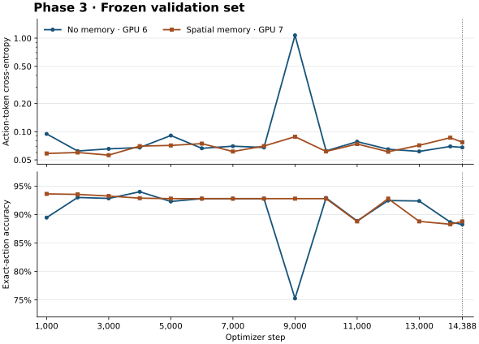

# 阶段 3 第二版布景训练与评测报告

2026 年 11 月 24 日 03:01，北京时间。运行目录为 `results/phase3-speed-xOn8Q5je`。

**无记忆和空间记忆两组均完成 14,388 个优化步，训练退出码均为 0，最终权重已保存。** 无记忆模型原版导航成功 6/10，新版偏角视野内成功 11/15，两项均低于预先规定的门槛。两组的正式 30 格评测均未产生回合结果，长窗口尚未训练。阶段 3 的空间记忆增益仍待闭环检验。 [最终状态和权重清单](phase3-speed-xOn8Q5je/final_checkpoints.json)

## 1. 训练协议与数据

使用第二版带折角入口的遮挡布景和同一冻结索引。索引 SHA-256 为 `f3a152816553499197053e18ce60e3837c899bed582eaa4cd913a71f52b5cefb`。四个 T1 档位各选 25,000 帧，另选 20,000 帧短距可见导航，训练共 **120,000 帧、57,549 条回程监督动作**。固定验证集为 6,500 帧、2,401 条动作和 11,751 个目标 token，索引中另有独立 6,500 帧测试集。索引核查中的重复种子、重复轨迹、跨划分世界种子交集及冻结评测种子交集均为 0。 [索引摘要](data/t1-screened-hzw7nYp7/index-full/summary.json) · [索引校验](data/t1-screened-hzw7nYp7/index_sha256.json)

两组使用 JARVIS-VLA Qwen2-VL-7B 公开权重、BF16 和 rank 64 LoRA。训练 LLM 注意力及 MLP 投影，冻结视觉编码器，缓存视觉特征，开启梯度检查点。共同设置为有效批大小 4、学习率 0.0001、随机种子 20261122、训练 1 个 epoch。损失只覆盖返回段动作 token。两组使用初始图像处理配置，并统一在每 1,000 步和最终一步验证。按预定规则取第 14,388 步的适配器。

无记忆模型使用当前帧与两帧历史。空间记忆模型保留相同的近期输入，并用真值位姿把早期视觉特征写入 32×32×8 网格，经 32 个查询读出后前缀拼接。训练可更新参数分别为 161,480,704 和 166,490,113。两组从服务器节点的已校验副本读取数据。GPU 6 使用 RAM 文件系统归档，GPU 7 使用节点磁盘归档。 [无记忆配置](phase3-speed-xOn8Q5je/train-no_memory/training_config.json) · [空间记忆配置](phase3-speed-xOn8Q5je/train-spatial/training_config.json) · [缓存校验](phase3-speed-xOn8Q5je/archive_sha256.jsonl) · [磁盘归档校验](phase3-speed-xOn8Q5je/archive_sha256_disk.jsonl)

## 2. 双卡实机与产物

| 项目 | 无记忆 · GPU 6 | 空间记忆 · GPU 7 |
| --- | ---: | ---: |
| 启动，北京时间 | 11 月 23 日 07:10:48 | 11 月 23 日 10:11:11 |
| 最终权重落盘 | 11 月 23 日 19:23:13 | 11 月 24 日 01:40:27 |
| 优化步 | 14,388 / 14,388 | 14,388 / 14,388 |
| 已用监督动作 | 57,549 / 57,549 | 57,549 / 57,549 |
| 训练程序总计时 | 12 小时 12 分 16 秒 | 15 小时 29 分 05 秒 |
| 15 次验证合计 | 1 小时 24 分 42 秒 | 1 小时 39 分 40 秒 |
| 端到端吞吐 | 1.31 条动作/秒 | 1.03 条动作/秒 |
| 扣除验证计时后的吞吐 | 1.48 条动作/秒 | 1.16 条动作/秒 |
| PyTorch 峰值分配 | 20.62 GiB | 20.69 GiB |
| 训练退出码 | 0 | 0 |

空间记忆组用时较无记忆组增加 26.9%。该差值来自实机总体运行，包含视觉编码、数据读取、验证和快照开销。两组训练 CSV 均从第 1 步连续记录到第 14,388 步。GPU 监控在 01:40:44 记录两组均完成后正常退出。03:01 的服务器采样显示两卡显存使用均为 0 MiB，温度分别为 37°C 和 30°C。 [无记忆训练日志](phase3-speed-xOn8Q5je/no_memory.log) · [空间记忆训练日志](phase3-speed-xOn8Q5je/spatial.log) · [监控事件](phase3-speed-xOn8Q5je/gpu-supervisor/events.jsonl) · [监督采样](phase3-speed-xOn8Q5je/gpu-supervisor/samples.jsonl)

最终权重留在 BAAI 的 `/share/project/zhoubowen/zhy/zyf/results/phase3-speed-xOn8Q5je`。以下为相对该目录的路径，均已在服务器复算 SHA-256。

| 权重 | 字节 | SHA-256 |
| --- | ---: | --- |
| `train-no_memory/adapter/adapter_model.safetensors` | 645,975,704 | `6ed32d5eb633c26f80aea8e3e677cbc1f1f5b136e4be2023d5a92ae06dd9c6be` |
| `train-spatial/adapter/adapter_model.safetensors` | 645,975,704 | `8de84a421357d20bc8bb67db355de4e6d26db763364ebd546d1d92ccfca0295a` |
| `train-spatial/spatial.safetensors` | 20,039,220 | `521296fc5254b68c562f8b049e3dddaf50285f03d7c7120fcf984f28523cd366` |

每组保留第 13,000 和 14,000 步的可恢复快照。清单记录文件大小与修改时间。空间记忆推理需要 LoRA 适配器和独立的空间记忆权重。 [权重与快照清单](phase3-speed-xOn8Q5je/final_checkpoints.json)

## 3. 完整开环验证

每次验证在相同的教师历史和目标动作前缀下计算 token 交叉熵和准确率。整条动作完全匹配要求该动作的所有目标 token 均正确。图中损失采用对数纵轴，竖虚线对应预定的末步检查点。

| 优化步 | 无记忆损失 | 无记忆 token | 无记忆整条动作 | 空间记忆损失 | 空间记忆 token | 空间记忆整条动作 |
| ---: | ---: | ---: | ---: | ---: | ---: | ---: |
| 1,000 | 0.09476 | 97.46% | 89.46% | 0.05859 | 98.37% | 93.63% |
| 2,000 | 0.06219 | 98.18% | 93.00% | 0.05997 | 98.48% | 93.54% |
| 3,000 | 0.06562 | 98.11% | 92.84% | 0.05620 | 98.25% | 93.25% |
| 4,000 | 0.06773 | 98.33% | 94.00% | 0.07015 | 98.21% | 92.88% |
| 5,000 | 0.09108 | 98.05% | 92.29% | 0.07138 | 98.20% | 92.79% |
| 6,000 | 0.06649 | 98.20% | 92.79% | 0.07461 | 98.20% | 92.79% |
| 7,000 | 0.07005 | 98.20% | 92.79% | 0.06140 | 98.20% | 92.79% |
| 8,000 | 0.06784 | 98.19% | 92.79% | 0.07034 | 98.11% | 92.79% |
| 9,000 | 1.07179 | 94.61% | 75.26% | 0.08847 | 97.86% | 92.79% |
| 10,000 | 0.06238 | 98.23% | 92.92% | 0.06157 | 98.11% | 92.79% |
| 11,000 | 0.07832 | 97.36% | 88.88% | 0.07392 | 97.32% | 88.80% |
| 12,000 | 0.06496 | 98.16% | 92.46% | 0.06111 | 98.14% | 92.79% |
| 13,000 | 0.06159 | 98.14% | 92.38% | 0.07155 | 97.32% | 88.80% |
| 14,000 | 0.06961 | 97.30% | 88.67% | 0.08626 | 97.03% | 88.30% |
| **14,388** | **0.06798** | **97.31%** | **88.25%** | **0.07719** | **97.23%** | **88.80%** |

末步空间记忆组多匹配 **13 条完整动作**（2,132 对 2,119，约 +0.54 个百分点）。其 token 匹配少 9 个，验证损失高约 0.00921。整条动作准确率的峰值分别出现在无记忆第 4,000 步和空间记忆第 1,000 步，最低损失分别出现在第 13,000 步和第 3,000 步。无记忆组在第 9,000 步出现明显验证波动，第 10,000 步恢复。审计显示这两个点的优化器步数和学习率正常，波动来源尚未确定。

训练标签中 forward 占 90.18%，yaw 中心档占 86.99%。验证集最常见的完整动作占 86.42%。离线总体准确率主要描述教师分布下的动作匹配，闭环需要在模型自己的控制历史下检验转向与纠错。 [无记忆验证 CSV](phase3-speed-xOn8Q5je/train-no_memory/val_loss.csv) · [空间记忆验证 CSV](phase3-speed-xOn8Q5je/train-spatial/val_loss.csv) · [验证波动复核](phase3-speed-xOn8Q5je/no_memory_validation_10000_audit.jsonl) · [动作标签分布](t1-review-A8vp1K1p/screened_return_actions.csv)

## 4. 导航门槛与失败轨迹

无记忆末步适配器在 GPU 6 闭环跑完全部 30 个导航场景。成功条件为 200 步内进入金柱水平 3 格且无死亡、位姿跳变。恒定前进使用相同的场景种子。

| 门槛场景 | 无记忆 | Wilson 95% 区间 | 恒定前进 | 判定 |
| --- | ---: | ---: | ---: | --- |
| 原版正前方 5 格 | 6/10（60.0%） | 31.3–83.2% | 10/10 | 低于 8/10，差 2 回合 |
| 新版偏角，视野内 | 11/15（73.3%） | 48.0–89.1% | 4/15 | 比恒定前进多 7 回合，距 12/15 差 1 回合 |
| 新版偏角，视野外 | 3/5（60.0%） | 23.1–88.2% | 0/5 | 观察项 |

原版恒定前进的 10 个回合均在 11 步完成。模型的 6 个成功回合耗时 155–191 步，4 个失败回合水平位置始终未变，各累计约 2,000 度绝对偏航。全部 30 个模型回合的死亡与位姿跳变均为 0。两个留出起始画面的 CPU FP32 单步诊断也复现了相机编码偏差，样本量仅为 2。报告归档了每个回合的 JSON 布景与逐步位姿 CSV，以便复算上述结论。 [原版 10 回合](phase3-speed-xOn8Q5je/eval-no_memory-nav/episodes.csv) · [偏角 20 回合](phase3-speed-xOn8Q5je/eval-no_memory-nav_offset/episodes.csv) · [恒定前进记录](t1-review-A8vp1K1p/forward-paired/worker-000/forward.csv) · [GPU 6 详细报告](REPORT_phase3_no_memory_gpu6.md)

## 5. 正式 T1 与阶段状态

第二版布景的 CPU 结构审计已通过。30、60、100 格找结构成功率的保守上界分别为 0%、0%、3.33%，三档均低于 10%。这是布景审计结果。正式模型评测以已通过的近距导航为前置条件。

| 项目 | 截止本次归档 |
| --- | --- |
| 无记忆 30 格 | 前置检查因原版可见导航低于 8/10 退出，0 个已评测回合 |
| 空间记忆 30 格 | 调度器读取到无记忆评测暂停，0 个已评测回合 |
| 10、60、100 格正式回程 | 两组均待评测 |
| 长窗口 | 新版索引训练尚未启动 |
| 原定继续条件 | 无记忆在 30 格少于 6/30，空间记忆高于 15/30，当前无可用于判断的正式回合 |

GitHub 归档含两组完整训练及验证 CSV、数值轨迹、配置、日志、监督采样、派生统计图和权重校验清单。原始 RGB、视频、模型权重及优化器快照保存在服务器。 [遮挡建筑审计](REPORT_phase3_structure_audit.md) · [无记忆评测日志](phase3-speed-xOn8Q5je/no_memory_eval.log) · [空间记忆调度日志](phase3-speed-xOn8Q5je/spatial_eval.log)
